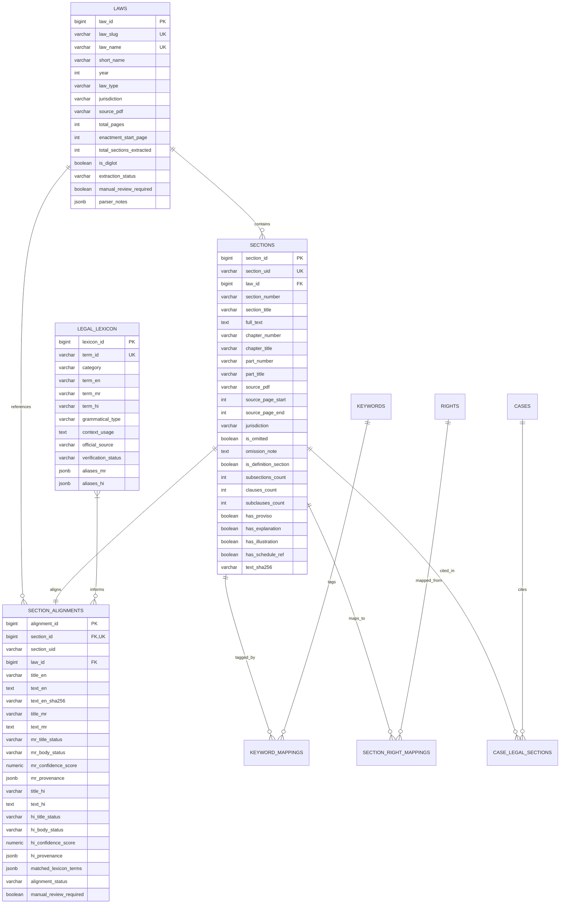

# Vidhik Legal Platform - Legal Dataset Database Mapping & Schema Design

## 1. Executive Summary

This document specifies the PostgreSQL relational staging architecture for the **Vidhik Legal Platform (Maharashtra MVP & Central Acts)**. 

The schema bridges the validated multi-pass staging outputs:
* `data/Legal_Dataset/Maharashtra_MVP/staging/laws_staging.json` (128 statutes)
* `data/Legal_Dataset/Maharashtra_MVP/staging/sections_staging.json` (10,248 provisions)
* `data/Legal_Dataset/Maharashtra_MVP/multilingual_staging/multilingual_lexicon_staging.json` (42 controlled legal terms)
* `data/Legal_Dataset/Maharashtra_MVP/multilingual_staging/section_language_alignment_staging.json` (10,248 aligned records)

---

## 2. Existing Database Inventory

An exhaustive inspection of the existing database directory (`database/`) revealed the following pre-existing table definitions:

| Subsystem | Existing Tables Discovered | Primary Key | Foreign Key Dependents |
| :--- | :--- | :--- | :--- |
| **Legal Dataset** | `laws`, `sections`, `keywords`, `keyword_mappings`, `legal_concepts`, `keyword_concepts`, `keyword_synonyms` | `BIGSERIAL` | `sections.law_id` -> `laws.law_id` `keyword_mappings` -> `sections`, `keywords` |
| **Rights & Remedies** | `rights`, `section_right_mappings` | `BIGSERIAL` | `section_right_mappings` -> `sections.section_id`, `rights.right_id` |
| **Case Management** | `cases`, `case_keywords`, `case_legal_sections`, `case_classifications`, `case_updates` | `BIGSERIAL` | `case_legal_sections` -> `cases.case_id`, `sections.section_id` |
| **Authorities & Lawyers**| `authorities`, `case_authorities`, `lawyer`, `lawyer_specializations`, `lawyer_languages`, `legal_aid_organizations` | `BIGSERIAL` | `case_authorities` -> `cases.case_id`, `authorities.authority_id` |
| **Authentication & Core**| `users`, `user_profiles`, `roles`, `user_roles`, `login_sessions`, `password_resets` | `BIGSERIAL` | `cases.user_id` -> `users.user_id` |

> [!IMPORTANT]
> **Zero Disruption Policy**: The staging design does not delete, rename, or drop any existing columns or tables. It extends existing tables (`laws`, `sections`) using non-breaking `ADD COLUMN IF NOT EXISTS` clauses, preserving all foreign key connections from `case_legal_sections`, `section_right_mappings`, and `keyword_mappings`.

---

## 3. Entity-Relationship Diagram (ERD)

---

## 4. Staging Data-to-Database Mapping

### 4.1. `laws` Table
* **Source Staging File**: `data/Legal_Dataset/Maharashtra_MVP/staging/laws_staging.json`

| JSON Field | DB Column | Data Type | Constraints & Logic |
| :--- | :--- | :--- | :--- |
| `law_id` (slug) | `law_slug` | `VARCHAR(255)` | `UNIQUE`, Indexed. URL-safe slug (e.g. `maharashtra-co-operative-societies-act-1960`) |
| `law_name` | `law_name` | `VARCHAR(500)` | `NOT NULL`, `UNIQUE` |
| `short_name` | `short_name` | `VARCHAR(255)` | Clean title for UI display |
| `year` | `year` | `INT` | Enactment year (e.g. `1960`, `2023`) |
| `law_type` | `law_type` | `VARCHAR(100)` | `'State Act'`, `'Central Act'`, `'Code'`, `'Constitution'` |
| `jurisdiction` | `jurisdiction` | `VARCHAR(100)` | `'Maharashtra'`, `'Central'`, `'India'` |
| `source_pdf` | `source_pdf` | `VARCHAR(255)` | Authoritative filename in repository |
| `total_pages` | `total_pages` | `INT` | Total pages in source document |
| `enactment_start_page` | `enactment_start_page` | `INT` | 1-indexed page where statutory body begins (skipping TOC) |
| `total_sections_extracted` | `total_sections_extracted` | `INT` | Total sections extracted by parser |
| `is_diglot` | `is_diglot` | `BOOLEAN` | `TRUE` if dual Hindi/English text present in source Gazette |
| `extraction_status` | `extraction_status` | `VARCHAR(100)` | `'extracted_from_source_pdf'`, `'incomplete_source_text'` |
| `manual_review_required` | `manual_review_required` | `BOOLEAN` | `TRUE` if OCR or structural anomaly detected |
| `parser_notes` | `parser_notes` | `JSONB` | Array of telemetry notes |

---

### 4.2. `sections` Table
* **Source Staging File**: `data/Legal_Dataset/Maharashtra_MVP/staging/sections_staging.json`

| JSON Field | DB Column | Data Type | Constraints & Logic |
| :--- | :--- | :--- | :--- |
| `section_id` (uid) | `section_uid` | `VARCHAR(255)` | `UNIQUE`, Indexed (e.g. `maharashtra-co-operative-societies-act-1960-sec-1`) |
| `law_id` | `law_id` | `BIGINT` | `NOT NULL`, Foreign Key -> `laws(law_id)` |
| `section_number` | `section_number` | `VARCHAR(50)` | `NOT NULL` (e.g. `'1'`, `'2A'`, `'154B'`, `'IV'`) |
| `section_title` | `section_title` | `VARCHAR(1000)` | English provision title |
| `full_text` | `full_text` | `TEXT` | Exact statutory body in English |
| `chapter_number` | `chapter_number` | `VARCHAR(100)` | e.g. `'CHAPTER I'` |
| `chapter_title` | `chapter_title` | `VARCHAR(500)` | e.g. `'PRELIMINARY'` |
| `part_number` | `part_number` | `VARCHAR(100)` | e.g. `'PART II'` |
| `part_title` | `part_title` | `VARCHAR(500)` | Part thematic heading |
| `source_pdf` | `source_pdf` | `VARCHAR(255)` | Authoritative PDF filename |
| `source_page_start` | `source_page_start` | `INT` | 1-indexed starting page in PDF |
| `source_page_end` | `source_page_end` | `INT` | 1-indexed ending page in PDF |
| `jurisdiction` | `jurisdiction` | `VARCHAR(100)` | `'Maharashtra'`, `'Central'` |
| `is_omitted` | `is_omitted` | `BOOLEAN` | `TRUE` for repealed/omitted provisions |
| `omission_note` | `omission_note` | `TEXT` | Reason or amendment citation |
| `is_definition_section` | `is_definition_section` | `BOOLEAN` | `TRUE` if section defines statutory terms |
| `subsections_count` | `subsections_count` | `INT` | Count of `(1)`, `(2)` provisions |
| `clauses_count` | `clauses_count` | `INT` | Count of `(a)`, `(b)` clauses |
| `subclauses_count` | `subclauses_count` | `INT` | Count of `(i)`, `(ii)` sub-clauses |
| `has_proviso` | `has_proviso` | `BOOLEAN` | `TRUE` if `Provided that...` present |
| `has_explanation` | `has_explanation` | `BOOLEAN` | `TRUE` if `Explanation.—...` present |
| `has_illustration` | `has_illustration` | `BOOLEAN` | `TRUE` if statutory illustrations present |
| `has_schedule_ref` | `has_schedule_ref` | `BOOLEAN` | `TRUE` if references schedules |
| *(computed)* | `text_sha256` | `VARCHAR(64)` | SHA-256 integrity hash of `full_text` |

---

### 4.3. `legal_lexicon` Table
* **Source Staging File**: `data/Legal_Dataset/Maharashtra_MVP/multilingual_staging/multilingual_lexicon_staging.json`

| JSON Field | DB Column | Data Type | Constraints & Logic |
| :--- | :--- | :--- | :--- |
| `term_id` | `term_id` | `VARCHAR(150)` | `NOT NULL`, `UNIQUE` slug |
| `category` | `category` | `VARCHAR(100)` | `'statutory_structure'`, `'penal_and_offences'`, etc. |
| `term_en` | `term_en` | `VARCHAR(300)` | `NOT NULL` English legal term |
| `term_mr` | `term_mr` | `VARCHAR(300)` | `NOT NULL` Marathi official equivalent |
| `term_hi` | `term_hi` | `VARCHAR(300)` | `NOT NULL` Hindi official equivalent |
| `grammatical_type` | `grammatical_type` | `VARCHAR(50)` | `'noun'`, `'noun_phrase'`, `'verb'` |
| `context_usage` | `context_usage` | `TEXT` | Juridical scope description |
| `official_source` | `official_source` | `VARCHAR(500)` | Government glossary reference |
| `verification_status` | `verification_status` | `VARCHAR(100)` | `'verified_authoritative'`, `'provisional_human_review_required'` |
| `aliases_mr` | `aliases_mr` | `JSONB` | Alternative Marathi synonyms |
| `aliases_hi` | `aliases_hi` | `JSONB` | Alternative Hindi synonyms |

---

### 4.4. `section_alignments` Table
* **Source Staging File**: `data/Legal_Dataset/Maharashtra_MVP/multilingual_staging/section_language_alignment_staging.json`

| JSON Field | DB Column | Data Type | Constraints & Logic |
| :--- | :--- | :--- | :--- |
| *(primary key)* | `alignment_id` | `BIGSERIAL` | Primary Key |
| *(foreign key)* | `section_id` | `BIGINT` | `NOT NULL`, `UNIQUE`, Foreign Key -> `sections(section_id)` |
| `section_id` (uid) | `section_uid` | `VARCHAR(255)` | Cross-reference identifier |
| `law_id` | `law_id` | `BIGINT` | `NOT NULL`, Foreign Key -> `laws(law_id)` |
| `title_en` | `title_en` | `VARCHAR(1000)` | Unmodified English title |
| `text_en` | `text_en` | `TEXT` | Unmodified English text |
| `text_en_sha256` | `text_en_sha256` | `VARCHAR(64)` | `NOT NULL` Cryptographic hash |
| `title_mr` | `title_mr` | `VARCHAR(1000)` | Nullable Marathi title |
| `text_mr` | `text_mr` | `TEXT` | Nullable Marathi body text |
| `mr_title_status` | `mr_title_status` | `VARCHAR(100)` | `'standard_statutory_heading'`, `'translation_unavailable'` |
| `mr_body_status` | `mr_body_status` | `VARCHAR(100)` | `'translation_unavailable'`, `'official_authoritative'` |
| `mr_confidence_score`| `mr_confidence_score` | `NUMERIC(3,2)` | Range: `0.00` to `1.00` |
| `mr_provenance` | `mr_provenance` | `JSONB` | Source metadata or legal caveat |
| `title_hi` | `title_hi` | `VARCHAR(1000)` | Nullable Hindi title |
| `text_hi` | `text_hi` | `TEXT` | Nullable Hindi body text |
| `hi_title_status` | `hi_title_status` | `VARCHAR(100)` | `'standard_statutory_heading'`, `'translation_unavailable'` |
| `hi_body_status` | `hi_body_status` | `VARCHAR(100)` | `'official_diglot_available'`, `'translation_unavailable'` |
| `hi_confidence_score`| `hi_confidence_score` | `NUMERIC(3,2)` | Range: `0.00` to `1.00` |
| `hi_provenance` | `hi_provenance` | `JSONB` | Source Gazette metadata |
| `matched_lexicon_terms`| `matched_lexicon_terms`| `JSONB` | Array of matched `term_id`s |
| `alignment_status` | `alignment_status` | `VARCHAR(100)` | `'standard_heading_aligned'`, `'translation_unavailable'` |
| `manual_review_required`| `manual_review_required`| `BOOLEAN` | `TRUE` if human translation required |

---

## 5. Migration Execution & Safety Protocol

1. **Non-Destructive Execution**: Applying `database/migrations/001_mvp_legal_staging_schema.sql` safely extends the existing tables without modifying existing records or breaking existing application relationships (`cases`, `rights`, `keywords`).
2. **Deterministic Data Load**: When approved, records from `laws_staging.json` (128 laws) and `sections_staging.json` (10,248 sections) can be imported into `laws` and `sections` respectively, followed by `legal_lexicon` and `section_alignments`.
3. **Automated Validation**: Running `database/validation/validate_legal_staging.sql` asserts that all foreign keys, uniqueness constraints, hash digests, and confidence scores satisfy zero-defect criteria.
