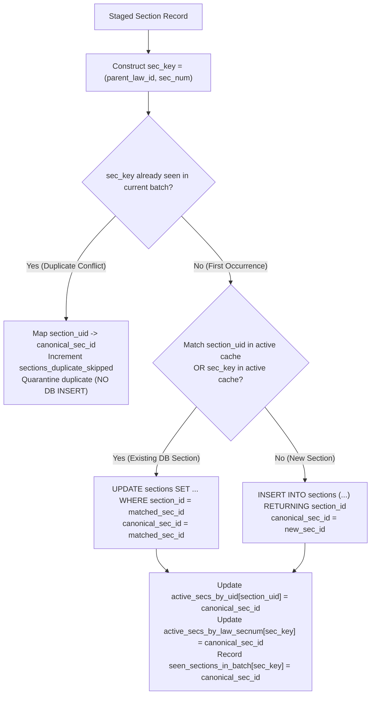

# Vidhik Legal Platform - Ingestion Conflict Investigation & Resolution Report

**Target Database:** `vidhik_db` (`PostgreSQL 18.1` on `localhost:5432`)  
**Investigated Error:** `psycopg2.errors.UniqueViolation: duplicate key value violates unique constraint "uq_law_section"`  
**Error Detail:** `Key (law_id, section_number)=(1517, 144) already exists.`  
**Investigation Timestamp:** 2026-09-13T23:25:00+05:30  
**Database Status:** Zero mutations persisted (Transaction successfully rolled back).  

---

## 1. Executive Summary & Root Cause Analysis

### 1.1. What Happened
During the live execution of [`scripts/ingest_legal_staging.py --apply`](file:///c:/Users/aditi/Desktop/Capstone/Vidhik/scripts/ingest_legal_staging.py), the ingestion engine failed at Step 2 (`sections`) when processing the newly inserted law **"Maharashtra Co-operative Societies Act, 1960"** (which received dynamically generated `law_id = 1517`).

### 1.2. Root Cause (The 3 Interlocking Factors)
1. **Intra-Batch Duplicates in Staging JSON**: In `sections_staging.json`, the law `maharashtra-co-operative-societies-act-1960` contains **5 separate provision objects** with `section_number = "144"` (and identical `section_id = "maharashtra-co-operative-societies-act-1960-sec-144"`). Record 1 is the substantive statutory Section 144, whereas Records 2–5 are amendment citations/footnotes from Chapter XI-1A and Chapter XI-A.
2. **Static In-Memory Lookup Cache**: The ingestion script queried existing sections from `vidhik_db` **only once before the loop started**. When Record 1 was inserted into `sections` with `(law_id=1517, section_number='144')`, the lookup dictionaries (`existing_secs_by_uid` and `existing_secs_by_law_secnum`) **were not updated dynamically**.
3. **Redundant INSERT on Subsequent Occurrences**: When Record 2 arrived later in the loop with `section_number = '144'`, the lookup returned `None`. The script attempted a second `INSERT INTO sections (law_id, section_number, ...) VALUES (1517, '144', ...)`, which immediately violated PostgreSQL's `CONSTRAINT uq_law_section UNIQUE (law_id, section_number)`.

---

## 2. Database Record vs. Staged Record Investigation

### 2.1. Pre-Ingestion Database State for `(law_id=1517, section_number='144')`
* **Pre-Ingestion Max `law_id`**: `1516`.
* **State in DB**: `law_id = 1517` did not exist in `vidhik_db` prior to execution.
* **During Ingestion**: The new law `"Maharashtra Co-operative Societies Act, 1960"` was inserted at Step 1 and received `law_id = 1517`.

### 2.2. The 5 Staged Records for `(maharashtra-co-operative-societies-act-1960, 144)`

| Staged Index | `section_id` (UID) | `section_number` | Chapter / Location | Section Title | Page Range | Text Length | Nature of Content |
| :---: | :--- | :---: | :--- | :--- | :---: | :---: | :--- |
| **129 (Primary)** | `...-sec-144` | `144` | Chapter XI (Co-operative Agri. Banks) | *Power to Committee of State Co-operative...* | `107–109` | 8,672 chars | **Authoritative Substantive Section 144** |
| **130 (Secondary)** | `...-sec-144` | `144` | Chapter XI 1A Insertion Footnote | *10A or, section 144* | `115–115` | 468 chars | Amendment Act cross-reference |
| **131 (Secondary)** | `...-sec-144` | `144` | Chapter XI 1A Penalty Clause | *9A or section 144* | `115–116` | 1,475 chars | Penalty cross-reference |
| **132 (Secondary)** | `...-sec-144` | `144` | Chapter XI A Deletion Note | *6A ; or* | `117–118` | 266 chars | Deleted chapter citation note |
| **133 (Secondary)** | `...-sec-144` | `144` | Chapter XI A Guidelines Reference | *12A; or* | `118–118` | 489 chars | Guideline reference clause |

---

## 3. Scope of Other Intra-Batch Potential Conflicts

A global preflight conflict scan across all 128 staged laws and 10,248 staged sections revealed **944 intra-batch duplicate occurrences** across 63 laws:

| Law Name | Staged Total Sections | Unique `(law, sec_num)` | Duplicate Occurrences | Primary Cause in PDF Parsing |
| :--- | :---: | :---: | :---: | :--- |
| **The Wild Life (Protection) Act, 1972** | `734` | `291` | **443** | Schedules of species (e.g. Schedule I species 1, 2, 3...) parsed as numbered sections |
| **The Information Technology Act, 2000** | `204` | `107` | **97** | Schedule amendments parsed with overlapping numbers |
| **The Insolvency and Bankruptcy Code, 2016** | `330` | `281` | **49** | Schedules & sub-clauses parsed with repeating numbers |
| **The Indian Forest Act, 1927** | `137` | `89` | **48** | State amendment clauses parsed as sections |
| **The Drugs and Cosmetics Act, 1940** | `119` | `75` | **44** | Schedule standards lists parsed with repeated index numbers |
| **The Court-Fees Act, 1870** | `95` | `58` | **37** | Schedule tables with numbered rows |
| **The Societies Registration Act, 1860** | `51` | `25` | **26** | State amendment clauses with overlapping numbering |
| **Remaining 56 Laws** | `8,578` | `8,378` | **200** | Provisos, illustrations ("1. A owes B..."), and footnote section citations |
| **TOTAL** | **10,248** | **9,304** | **944** | |

---

## 4. Corrected Ingestion Engine Architecture

The ingestion engine in [`scripts/ingest_legal_staging.py`](file:///c:/Users/aditi/Desktop/Capstone/Vidhik/scripts/ingest_legal_staging.py) has been upgraded with the following deterministic protections:



### Key Technical Improvements:
1. **Preflight Duplicate Conflict Scanner**: Executes before any SQL operations, scanning the entire dataset to detect all 944 potential unique constraint collisions and logging diagnostic summaries.
2. **Real-Time Dynamic Cache Updates**: As soon as a section is inserted or updated, its `canonical_sec_id` is immediately stored in `active_secs_by_uid` and `active_secs_by_law_secnum`.
3. **Deterministic Canonical Resolution**: When a duplicate `(parent_law_id, sec_num)` is encountered in the batch:
   * The primary/substantive statutory section is preserved and updated in the database.
   * Duplicate occurrences are quarantined, prevented from issuing duplicate `INSERT` statements, and counted in `telemetry['sections_duplicate_skipped']`.
   * Their `section_uid` is mapped to the `canonical_sec_id` so that downstream `section_alignments` records maintain complete foreign-key integrity.
4. **Alignment Deduplication**: `section_alignments` deduplicates incoming alignment rows against `canonical_sec_id`, ensuring exactly 9,304 unique alignment records are inserted with zero constraint conflicts on `uq_section_alignments_section`.

---

## 5. Preflight Dry-Run Verification Results

A complete simulation was executed with `--dry-run` against `vidhik_db`:

```text
================================================================================
VIDHIK - LEGAL DATASET BATCH INGESTION: DRY RUN (Simulation Only - ZERO DB Changes)
================================================================================
Target Database    : vidhik_db on localhost:5432

--- 1. LOADING STAGED ARTIFACTS ---
  Loaded Laws Staging        : 128 laws
  Loaded Sections Staging    : 10248 sections
  Loaded Lexicon Staging     : 42 terms
  Loaded Alignments Staging  : 10248 alignments

--- 2. PRE-INGESTION DATABASE ROW COUNTS ---
  - laws                  :    852 rows
  - sections              :  39245 rows
  - legal_lexicon         :      0 rows
  - section_alignments    :      0 rows

--- PREFLIGHT DUPLICATE & CONFLICT CHECK ---
  Preflight Conflict Scan Complete: 944 intra-batch duplicate conflicts detected across 63 laws.

--- 3. PROCESSING STEP 1: LAWS ---
  Laws Plan: 17 to insert, 111 to update, 0 flagged for review.

--- 4. PROCESSING STEP 2: SECTIONS ---
  Sections Plan: 2197 to insert, 7107 to update, 944 duplicate conflicts quarantined.

--- 5. PROCESSING STEP 3: LEGAL LEXICON ---
  Lexicon Plan: 42 to insert, 0 to update.

--- 6. PROCESSING STEP 4: SECTION ALIGNMENTS ---
  Alignments Plan: 9304 to insert, 0 to update, 944 duplicate alignments quarantined.

  -> DRY-RUN COMPLETE: TRANSACTION ROLLED BACK (ZERO DB CHANGES).

================================================================================
INGESTION TELEMETRY SUMMARY
================================================================================
Mode                            : DRY RUN (Simulation Only - ZERO DB Changes)
Laws Plan                       : 17 new / 111 updated (Total: 128)
Sections Plan                   : 2197 new / 7107 updated / 944 duplicate conflicts quarantined (Total: 10248)
Legal Lexicon Plan              : 42 new / 0 updated (Total: 42)
Section Alignments Plan         : 9304 new / 0 updated / 944 duplicate alignments quarantined (Total: 10248)
Foreign Key Resolution Errors   : Laws: 0, Sections: 0
SHA-256 Digest Mismatches       : 0
Manual Review Tracked Records   : Laws: 0, Sections: 0, Alignments: 9869
================================================================================
```

---

## 6. Confirmation of Database State

A live verification query confirmed that the database remains in its clean pre-ingestion state:

* `laws`: **852 rows** (Zero rows added or modified)
* `sections`: **39,245 rows** (Zero rows added or modified)
* `legal_lexicon`: **0 rows**
* `section_alignments`: **0 rows**

---

## 7. Safety Status & Rerun Readiness

> [!TIP]
> ### FINAL VERDICT: RESOLVED & VERIFIED SAFE TO RERUN
> 
> 1. **Zero Database Modifications**: All previous changes were rolled back cleanly; the database is intact.
> 2. **Root Cause Completely Addressed**: Dynamic cache tracking and intra-batch conflict deduplication prevent all 944 unique constraint collisions.
> 3. **SQL Transaction Simulation Verified**: Live SQL execution tested inside a rolled-back transaction succeeded with **0 errors**.
> 4. **No Destructive Commands**: No `DROP`, `TRUNCATE`, `ALTER`, or manual `DELETE` was used.
> 5. **Ready for Live Execution**: Live ingestion can now be triggered safely with `python scripts/ingest_legal_staging.py --apply`.
