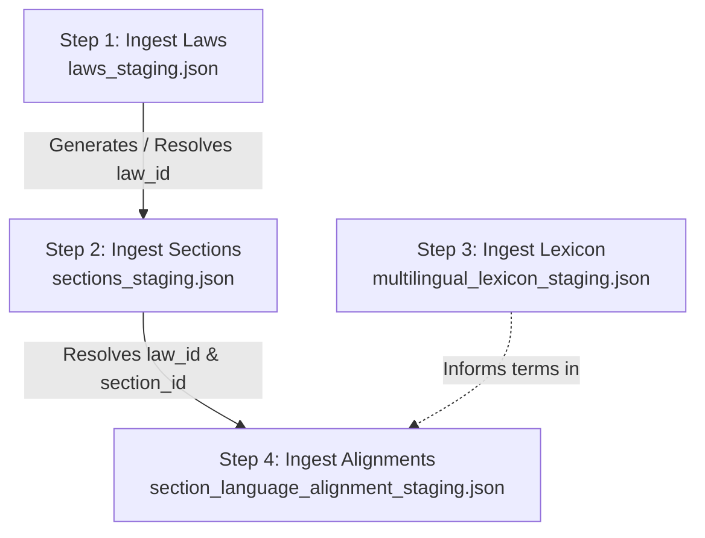

# Vidhik Legal Platform - Legal Dataset Batch Ingestion Workflow

## 1. Overview & Import Architecture

This document outlines the deterministic, non-destructive batch ingestion pipeline implemented in [`scripts/ingest_legal_staging.py`](file:///c:/Users/aditi/Desktop/Capstone/Vidhik/scripts/ingest_legal_staging.py).

The workflow safely migrates the 128 Maharashtra MVP Statutes, 10,248 Statutory Sections, 42 Controlled Lexicon Terms, and 10,248 Multilingual Alignments from validated JSON staging files into the PostgreSQL production schema (`vidhik_db`).

---

## 2. Ingestion Order & Dependency Graph

1. **Step 1: `laws` Table**:
   - Ingests `laws_staging.json` (128 laws).
   - Generates or updates `laws.law_slug`, `source_pdf`, `enactment_start_page`, and telemetry.
   - Builds in-memory map: `law_slug -> law_id (BIGINT)`.
2. **Step 2: `sections` Table**:
   - Ingests `sections_staging.json` (10,248 sections).
   - Resolves `law_id` via `law_slug`.
   - Generates or updates `sections.section_uid`, `full_text`, structural counts, and `text_sha256`.
   - Builds in-memory map: `section_uid -> section_id (BIGINT)`.
3. **Step 3: `legal_lexicon` Table**:
   - Ingests `multilingual_lexicon_staging.json` (42 controlled legal terms).
   - Populates English, Marathi, and Hindi verified terms with category indexes.
4. **Step 4: `section_alignments` Table**:
   - Ingests `section_language_alignment_staging.json` (10,248 alignments).
   - Resolves `section_id` via `section_uid` and `law_id` via `law_slug`.
   - Populates multilingual titles, bodies, confidence scores, and provenance objects.

---

## 3. Identifier Mappings & Surrogate Keys

| Staging JSON Identifier | Target PostgreSQL Column | PostgreSQL Key Type | Mapping Mechanism |
| :--- | :--- | :--- | :--- |
| `law.law_id` (`"the-arms-act-1959"`) | `laws.law_slug` | `VARCHAR(255) UNIQUE` | Natural unique slug mapped to auto-generated `laws.law_id BIGINT`. |
| `section.section_id` (`"...-sec-1"`) | `sections.section_uid` | `VARCHAR(255) UNIQUE` | Stable unique UID mapped to auto-generated `sections.section_id BIGINT`. |
| `lexicon.term_id` (`"short-title-..."`) | `legal_lexicon.term_id`| `VARCHAR(150) UNIQUE` | Natural unique slug key for terminology queries. |
| `alignment.section_id` | `section_alignments.section_id` | `BIGINT UNIQUE FK` | Direct 1-to-1 foreign key to `sections(section_id)`. |

---

## 4. Duplicate & Upsert Rules

1. **Laws Table Matching**:
   * Matched first by `law_slug`, then by `LOWER(TRIM(law_name))`.
   * **If Match Found**: Performs non-destructive `UPDATE` on staging metadata (`law_slug`, `year`, `source_pdf`, etc.), retaining the existing integer `law_id`. Existing foreign keys from `sections` or `law_applicability` remain 100% intact.
   * **If No Match**: Performs `INSERT` with new `BIGSERIAL` `law_id`.
2. **Sections Table Matching**:
   * Matched first by `section_uid`, then by composite `(law_id, section_number)`.
   * **If Match Found**: Performs non-destructive `UPDATE` on text, chapter hierarchy, provenance, and structural flags. Existing `section_id` is preserved, protecting live relationships in `keyword_mappings`, `section_right_mappings`, and `case_legal_sections`.
   * **If No Match**: Performs `INSERT` with new `BIGSERIAL` `section_id`.
3. **Lexicon & Alignments Tables Matching**:
   * Ingested via `ON CONFLICT (term_id) DO UPDATE` and `ON CONFLICT (section_id) DO UPDATE`.

---

## 5. Transaction Handling & Rollback Safety

* **Atomic Transaction**: The entire 4-step pipeline runs inside a single database transaction (`BEGIN ... COMMIT`).
* **Dry-Run Mode (`--dry-run`)**: Default execution mode. Executes all lookup, duplicate detection, and foreign key verification queries, then executes `conn.rollback()`, ensuring **zero mutations** to the database.
* **Live Apply Mode (`--apply`)**: Executes live batch inserts/updates and issues `conn.commit()` only if all 4 steps succeed without exception. If any error or constraint violation occurs at any point, `conn.rollback()` is automatically invoked.
* **Pre-Migration Snapshot**: Full database dump preserved at:
  `database/backups/vidhik_db_pre_migration_002_backup.dump` (4.33 MB).

---

## 6. Manual-Review Handling

* **Explicit Tracking**: Staged records with `manual_review_required = TRUE` (e.g. J&K Official Languages Act, 2020 or non-standard section titles) are preserved with `manual_review_required = TRUE` in database records.
* **No Translation Invention**: Sections without authoritative Marathi or Hindi texts have `text_mr = NULL` and `text_hi = NULL`, with status explicitly marked as `translation_unavailable`. Zero unverified machine translations are ingested.
