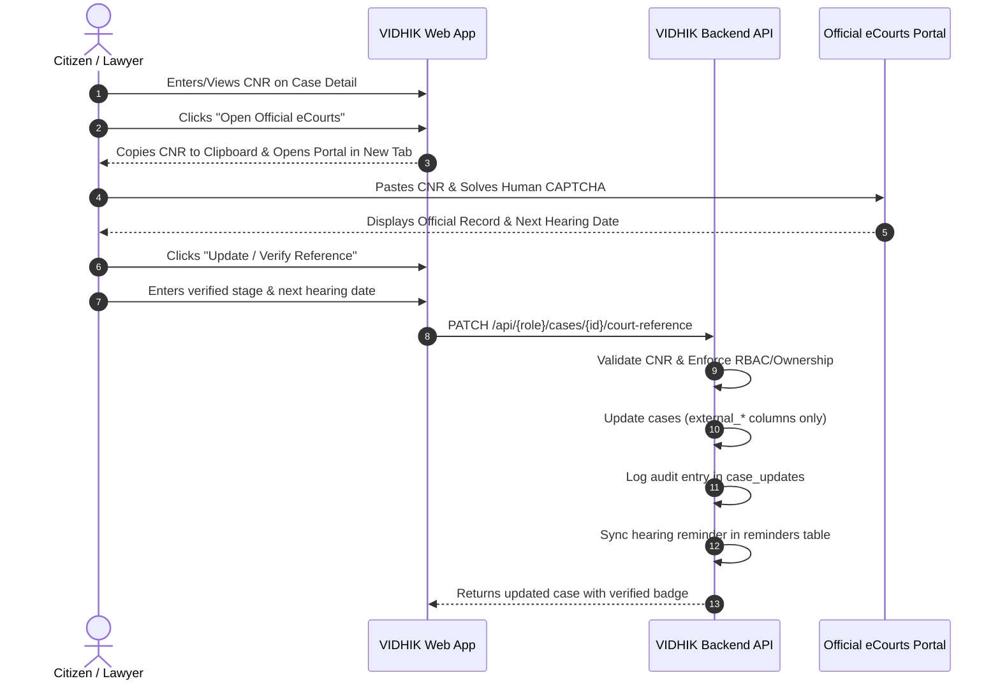

# VIDHIK — Official eCourts CNR Case Tracking Integration Architecture

## 1. Overview & Core Philosophy

The **VIDHIK eCourts Integration** enhances the existing Case Tracking system with an official Indian eCourts reference layer via the standardized 16-character **Case Number Record (CNR)**. 

### Core Architectural Principle: User-Assisted CNR Lookup + Dual-Track Case Model
VIDHIK implements a **Dual-Track Case Model** where internal management and external official records remain distinct:
1. **Internal VIDHIK Lifecycle**: Confidential case notes, internal workflow status (`active`, `pending`, `resolved`, `closed`, `withdrawn`), client-lawyer communications, internal task reminders, and uploaded documents.
2. **Official Court Reference Layer**: The 16-character CNR, official court portal URL, user-verified official status/stage, user-verified next court hearing date, and verification timestamps.

> **Mandatory Policy Statement:**
> **VIDHIK does not automatically scrape or modify eCourts records. Users are directed to the official eCourts portal for authoritative court information.**

---

## 2. Strict Compliance & No-Scraping Policy

VIDHIK adheres strictly to Indian legal informatics governance, IT Act guidelines, and cybersecurity standards:
- **No Automated Scraping**: No HTTP scraping, DOM parsing, or unofficial background requests against eCourts portals (`services.ecourts.gov.in` or `ecourts.gov.in`).
- **No CAPTCHA Automation or Bypass**: CAPTCHAs remain 100% human/user-solved directly on the official government website.
- **No Headless Browsers**: No Selenium, Playwright, Puppeteer, or headless browsers interact with government infrastructure.
- **No Fictional APIs**: No fabricated or undocumented endpoints.
- **No Stored External Government Dumps**: VIDHIK stores only the user-provided CNR reference and manually verified metadata.

---

## 3. What is a CNR Number?

A **CNR (Case Number Record)** is a unique 16-character alphanumeric identifier assigned to every case filed in Indian District and High Courts under the eCourts Project.

### Format Structure (16 alphanumeric characters)
```
  [State: 2] [District: 2] [Establishment: 2] [Case Reg Number: 6] [Year: 4]
  Example: MHAU010123452023
```
- **State Code (2 letters)**: e.g., `MH` for Maharashtra, `DL` for Delhi, `KA` for Karnataka.
- **District / Court Complex Code (2 letters/digits)**: e.g., `AU` for Aurangabad, `PU` for Pune.
- **Establishment Code (2 digits/letters)**: Unique establishment/court identifier.
- **Case Number (6 digits)**: Zero-padded case registration number.
- **Filing Year (4 digits)**: e.g., `2023`, `2024`, `2026`.

### Backend Validation Rules (`backend/app/core/cnr_validator.py`)
- Trims leading and trailing whitespace.
- Converts input to uppercase.
- Enforces exactly 16 characters (`len == 16`).
- Enforces strict alphanumeric characters (`[A-Z0-9]{16}`).
- Rejects spaces, hyphens, slashes, punctuation, and malformed strings.
- Does not enforce fictional checksums, ensuring compatibility with all Indian courts.

---

## 4. User-Assisted eCourts Workflow



---

## 5. Database Schema & Migration (`010_ecourts_case_tracking_schema.sql`)

Non-destructive extension to the `cases` table:
```sql
ALTER TABLE cases ADD COLUMN IF NOT EXISTS cnr_number VARCHAR(16);
ALTER TABLE cases ADD COLUMN IF NOT EXISTS court_source VARCHAR(100) DEFAULT 'eCourts India';
ALTER TABLE cases ADD COLUMN IF NOT EXISTS official_case_url TEXT;
ALTER TABLE cases ADD COLUMN IF NOT EXISTS last_verified_at TIMESTAMP;
ALTER TABLE cases ADD COLUMN IF NOT EXISTS external_status VARCHAR(150);
ALTER TABLE cases ADD COLUMN IF NOT EXISTS external_next_hearing_date DATE;

CREATE INDEX IF NOT EXISTS idx_cases_cnr_number ON cases(cnr_number);
```

### Separation of State (Dual-Track Model)
| Field | Purpose | Managed By |
|---|---|---|
| `cases.status` | Internal VIDHIK lifecycle (`active`, `pending`, `resolved`, `closed`) | VIDHIK User / Assigned Lawyer |
| `cases.external_status` | Official court stage (e.g., `Notice Issued`, `Evidence Stage`, `Stay Granted`) | User-verified from eCourts |
| `cases.external_next_hearing_date` | Official next listing date from court record | User-verified from eCourts |
| `cases.last_verified_at` | Timestamp of last user verification | Automatically updated on submission |

---

## 6. Security & Authorization Model

1. **Strict Ownership Boundaries**:
   - **Citizen Endpoint**: Authenticated user must own the case (`cases.user_id = authenticated_user.id`). Unowned cases return `404 Not Found`.
   - **Lawyer Endpoint**: Authenticated lawyer must be assigned to the case (`cases.assigned_lawyer_id = lawyer_id`). Unassigned cases return `404 Not Found`.
2. **Confidentiality & Lawyer Notes**:
   - Private lawyer notes (`case_notes`) remain strictly isolated in the lawyer workspace and are **never** returned to citizen endpoints.
3. **Parameterized SQL Queries**:
   - All SQL operations use parameter substitution (`%s`), preventing SQL injection.
4. **No External Credentials**:
   - Zero eCourts API keys, scrape tokens, or third-party proxy credentials exist in the system.

---

## 7. API Specification

### 1. Update Court Reference (Lawyer)
- **Endpoint**: `PATCH /api/lawyer/cases/{case_id}/court-reference`
- **Auth**: JWT Bearer Token (`require_lawyer`)
- **Request Body**:
  ```json
  {
    "cnr_number": "MHAU010123452023",
    "court_source": "eCourts India",
    "external_status": "Evidence Stage",
    "external_next_hearing_date": "2026-12-10",
    "sync_hearing_reminder": true
  }
  ```
- **Response**: `200 OK` (`CaseDetailResponse`)

### 2. Update Court Reference (Citizen)
- **Endpoint**: `PATCH /api/citizen/cases/{case_id}/court-reference`
- **Auth**: JWT Bearer Token (`require_citizen`)
- **Request Body**:
  ```json
  {
    "cnr_number": "MHPU020054322024",
    "court_source": "eCourts India",
    "external_status": "Written Statement Filed",
    "external_next_hearing_date": "2026-11-28",
    "sync_hearing_reminder": true
  }
  ```
- **Response**: `200 OK` (`CitizenCaseDetailResponse`)

---

## 8. Frontend Integration Contract for Partner 3

For Partner 3's UI development:

### Data Model (`court_reference` Object in Case Detail)
```typescript
interface CourtReference {
  cnr_number: string | null;
  court_source: string;
  official_case_url: string | null;
  last_verified_at: string | null; // ISO Date String
  external_status: string | null;
  external_next_hearing_date: string | null; // YYYY-MM-DD
  is_verified: boolean;
  portal_url: string; // "https://services.ecourts.gov.in/ecourtindia_v6/"
}
```

### UI Component Actions
1. **Copy CNR & Open Portal**:
   - Copy `case.cnr_number` to system clipboard via `navigator.clipboard.writeText(cnr)`.
   - Open `case.court_reference.portal_url` via `window.open(url, '_blank')`.
   - Show notification toast: `"CNR copied to clipboard. Paste into eCourts portal."`
2. **Update / Verify Action**:
   - Modal trigger requesting `cnr_number`, `external_status`, and `external_next_hearing_date`.
   - Sends `PATCH` request to role-specific endpoint.

---

## 9. Verification & Automated Test Coverage

- Full automated test suite passes with **185/185 tests** (156 baseline + 29 dedicated eCourts integration tests).
- Zero deprecation or runtime regressions.
